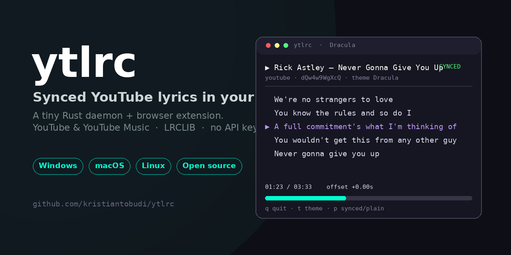

# ytlrc — lirik YouTube di terminal

[](https://github.com/kristiantobudi/ytlrc/actions/workflows/build.yml)
[](LICENSE)
[](CHANGELOG.md)
[](https://www.rust-lang.org)
[](#dukungan-platform)



[English](README.md) · **Bahasa Indonesia**

**ytlrc** menampilkan **lirik YouTube yang sinkron di terminal**. Tools
open-source berbasis Rust + extension Chrome/Edge ini mendeteksi lagu yang sedang
diputar di **YouTube atau YouTube Music**, mengambil liriknya dari
[LRCLIB](https://lrclib.net), lalu menyorot baris yang sedang dinyanyikan seiring
musik berjalan. Berjalan di **Windows, macOS, dan Linux** — tanpa API key, tanpa
akun, tanpa audio fingerprinting, binary hanya ~1,4 MB.

> Mencari cara melihat lirik YouTube di terminal, pemutar lirik CLI, penampil LRC
> sinkron, atau now-playing ringan? ytlrc dibuat untuk itu.

```
┌─ Now Playing ─────────────────────────────────────┐
│ ▶ Rick Astley — Never Gonna Give You Up    SYNCED │
│ youtube • dQw4w9WgXcQ  •  theme Dracula           │
├───────────────────────────────────────────────────┤
│        We're no strangers to love                 │
│        You know the rules and so do I             │
│   ▶    A full commitment's what I'm thinking of   │
│        You wouldn't get this from any other guy   │
├───────────────────────────────────────────────────┤
│ 01:23 / 03:33   offset +0.00s                     │
│ q quit · t theme · +/- offset · p synced/plain    │
└───────────────────────────────────────────────────┘
```

## Mulai cepat

1. Install extension browser sekali: lihat [Install extension](#install-extension-sekali).
2. Build dan jalankan daemon sesuai OS: lihat [Dukungan platform](#dukungan-platform).
3. Putar lagu di YouTube. Lirik muncul otomatis; pergantian lagu memicu
   pencarian baru tanpa menekan tombol.

```bash
# Linux / WSL (binary statis)
./build.sh && ./ytlrc --bind 0.0.0.0

# macOS
./build.sh && ./ytlrc

# Windows (PowerShell)
.\build.ps1; .\ytlrc.exe
```

## Daftar isi

- [Kenapa ytlrc?](#kenapa-ytlrc)
- [Cara kerja](#cara-kerja)
- [Fitur](#fitur)
- [Dukungan platform](#dukungan-platform)
- [Prasyarat](#prasyarat)
- [Build dan jalankan](#build-dan-jalankan)
- [Install extension](#install-extension-sekali)
- [File dan konfigurasi](#file-dan-konfigurasi)
- [Opsi CLI](#opsi-cli)
- [Tema](#tema)
- [Keybinding TUI](#keybinding-tui)
- [Cara kerja pencarian otomatis](#cara-kerja-pencarian-otomatis)
- [FAQ](#faq)
- [Troubleshooting](#troubleshooting)
- [Struktur project](#struktur-project)
- [Kontribusi](#kontribusi)
- [Batasan](#batasan)
- [Kredit](#kredit)

## Kenapa ytlrc?

| | **ytlrc** | Situs lirik | Tools lirik khusus Spotify |
| --- | --- | --- | --- |
| Mendukung YouTube / YouTube Music | ✅ | ✅ | ❌ |
| Lirik sinkron & auto-scroll | ✅ | kadang | ✅ |
| Berjalan di terminal (SSH, tmux, tiling WM) | ✅ | ❌ | ❌ |
| Open source, tanpa akun, tanpa API key | ✅ | ❌ | ❌ |
| Satu binary native kecil (Windows/macOS/Linux) | ✅ | ❌ | ❌ |
| Retry otomatis + deteksi pergantian lagu | ✅ | ❌ | ❌ |

## Cara kerja

```
Chrome / Edge / Brave (youtube.com, music.youtube.com)
  content.js   membaca judul/artis mediaSession, currentTime, durasi, iklan
      │ chrome.runtime.sendMessage (~1 detik atau setiap ada perubahan)
      ▼
  background.js memilih tab yang sedang ditonton ── POST /state
                                                        │
                                                        ▼
                                           Rust daemon (127.0.0.1:8765)
                                             • parser judul → artis/judul
                                             • LRCLIB (/api/get → /api/search)
                                             • cache disk per track
                                             • parser LRC + offset
                                                        │
                                                        ▼
                                              TUI ratatui di terminal
```

Deteksi memakai metadata halaman dan `mediaSession`, **bukan** audio
fingerprinting, sehingga `currentTime` bisa langsung dipakai untuk sinkronisasi.
Berjalan di Windows, Linux, dan macOS.

## Fitur

- Deteksi lagu otomatis + lirik sinkron (LRC) dengan highlight baris aktif.
- **5 tema interaktif**: Neon, Dracula, Nord, Gruvbox, Mono. Ganti tanpa restart;
  pilihan diingat.
- **Pencarian otomatis berlapis**: jika gagal, ytlrc mencoba lagi sendiri dengan
  query berbeda (artis utama, nama channel, judul saja, judul mentah) memakai
  jeda 8s → 25s → 90s → 240s → tiap 5 menit.
- **Pergantian lagu terdeteksi otomatis**, termasuk live stream atau mix yang
  berganti lagu tanpa berganti video id.
- Proteksi state basi: jika lirik yang tampil tidak lagi cocok dengan track saat
  ini, pencarian baru langsung dijalankan (tanpa reload manual).
- Sadar iklan: lirik berhenti saat iklan dan lanjut setelahnya.
- Aman multi-tab: hanya tab yang benar-benar ditonton yang dikirim.
- Offset manual (`+` / `-`), toggle synced/plain, refetch tanpa cache, dan
  pencarian manual.
- Mode `--print` untuk script / overlay streaming, dengan auto-retry yang sama
  seperti TUI.
- Token API opsional (`--token` / `YTLRC_TOKEN`) untuk WSL/LAN; CORS dibatasi ke
  origin YouTube dan extension browser.
- Perawatan cache saat startup: entri kedaluwarsa, file temp sisa crash, dan
  record tertua di atas 500 file dihapus otomatis.
- Satu binary statis, tanpa runtime. RAM tipikal ~10–15 MB.

## Dukungan platform

| OS | Status | Catatan |
| --- | --- | --- |
| **Windows 10/11** | `.exe` native atau WSL | Build native disarankan; WSL tetap didukung |
| **Ubuntu / Debian / Fedora / Arch** | Binary musl statis | Tanpa dependensi runtime |
| **macOS 12+ (Intel & Apple Silicon)** | Build native | Butuh Xcode Command Line Tools saat build |

Extension browser sama untuk semua OS. Daemon mendengarkan di `127.0.0.1:8765`
secara default; hanya launcher WSL yang memakai `0.0.0.0` agar bisa diakses dari
Windows.

CI menguji dan membangun project di Ubuntu, macOS, dan Windows, serta menghasilkan
binary Linux statis pada setiap push.

## Prasyarat

- Rust (stable) — hanya untuk build: <https://rustup.rs>
- `curl` di `PATH` (untuk request ke LRCLIB). Sudah tersedia di Windows 10+,
  macOS, dan hampir semua distro Linux.
- Chrome, Edge, Brave, atau browser Chromium lain yang mendukung Manifest V3.

## Build dan jalankan

### Package manager (awal, SHA256 belum dipublikasikan)

Folder `packaging/` berisi manifest siap pakai setelah checksum rilis diisi:

```bash
# Nix
nix build .                       # atau: nix run .

# Homebrew (file formula lokal)
brew install --formula ./packaging/homebrew/ytlrc.rb

# Scoop (file manifest lokal)
scoop install ./packaging/scoop/ytlrc.json

# Arch Linux (build dari source)
cd packaging/aur && makepkg -si
```

Submission winget memakai `packaging/winget/*.yaml` sebagai titik awal PR ke
[microsoft/winget-pkgs](https://github.com/microsoft/winget-pkgs). Belum ada
yang dipublikasikan ke tap/bucket/repo resmi — lihat
[docs/GITHUB_SETUP.md](docs/GITHUB_SETUP.md) untuk checklist publikasinya.

### Windows (native, disarankan)

1. Install **Rust** (rustup) dengan toolchain MSVC default.
2. Install **Visual Studio Build Tools** dengan workload *Desktop development
   with C++* (linker MSVC dibutuhkan Rust).
3. Di PowerShell:

   ```powershell
   cd D:\Project\ytlrc
   .\build.ps1
   .\ytlrc.exe
   ```

   `build.ps1` membangun `target\release\ytlrc.exe` lalu menyalinnya ke
   `.\ytlrc.exe`.

Gunakan **Windows Terminal** agar warna Unicode dan gauge tampil rapi. Di
`cmd.exe` lama, jalankan `chcp 65001` lebih dulu.

### Windows (WSL)

```bash
cd /mnt/d/Project/ytlrc
./build.sh                                   # binary Linux statis
./ytlrc --bind 0.0.0.0                       # wajib untuk browser di Windows
```

Dari Command Prompt, `ytlrc.cmd` menjalankan build WSL dan otomatis menambahkan
`--bind 0.0.0.0` supaya browser di Windows bisa menjangkau daemon.

### Ubuntu / Linux

```bash
sudo apt install -y curl        # jika curl belum ada
cd /mnt/d/Project/ytlrc
./build.sh
./ytlrc
```

`build.sh` menghasilkan binary musl statis
(`target/x86_64-unknown-linux-musl/release/ytlrc`) dan menyalinnya ke `./ytlrc`.
Script ini tetap bekerja di distro tanpa `gcc` karena memakai `rust-lld` dan
toolchain Zig portabel untuk build script. Kalau mesinmu punya
`build-essential`, `cargo build --release` biasa juga bisa.

### macOS

```bash
xcode-select --install           # sekali, menyediakan clang
cd ~/ytlrc
./build.sh                       # atau: cargo build --release
./ytlrc
```

- Apple Silicon membangun `aarch64` secara native; Intel membangun `x86_64`.
- Untuk universal binary:
  `rustup target add x86_64-apple-darwin aarch64-apple-darwin`, build keduanya,
  lalu gabungkan dengan `lipo -create -output ytlrc ...`.
- iTerm2, Terminal.app, dan terminal VS Code semuanya bisa; iTerm2 memberi warna
  terbaik.

### Build manual (semua platform)

```bash
cargo build --release
# Linux:   target/release/ytlrc
# macOS:   target/release/ytlrc
# Windows: target\release\ytlrc.exe
```

### Memakai beberapa device

- Setiap mesin menjalankan daemon dan salinan extension sendiri. Tidak ada
  sinkronisasi antar-device.
- Load extension terpisah di setiap profil browser
  (`Load unpacked` → folder `extension/`).
- Secara default daemon hanya menerima koneksi dari mesin yang sama
  (`127.0.0.1`). Untuk mengendalikan daemon di komputer lain, jalankan dengan
  `--bind 0.0.0.0 --token <rahasia>`, ubah `DAEMON_URL` dan `TOKEN` di
  `extension/background.js` menjadi `http://<ip-tujuan>:8765/state` dan rahasia
  yang sama, tambahkan alamatnya ke `host_permissions`, lalu reload extension.
  Tanpa `--token` endpoint tidak terautentikasi, jadi hanya pakai di jaringan
  tepercaya.
- Binary hasil unduhan CI/release: di macOS jalankan
  `chmod +x ./ytlrc && xattr -d com.apple.quarantine ./ytlrc`; di Windows,
  SmartScreen mungkin meminta konfirmasi saat pertama dijalankan.

## Install extension (sekali)

1. Buka `chrome://extensions` (atau `edge://extensions`, `brave://extensions`).
2. Aktifkan **Developer mode**.
3. Klik **Load unpacked** dan pilih folder `extension/`.
4. Pin **ytlrc bridge**. Extension berjalan otomatis; tidak perlu diklik.
5. Jalankan daemon ytlrc, lalu putar lagu di YouTube.

Jika port daemon diganti, ubah `DAEMON_URL` di `extension/background.js` dan
`host_permissions` di `extension/manifest.json`, lalu reload extension.

### Firefox

Manifest extension ini menyasar Manifest V3 untuk browser Chromium (Chrome,
Edge, Brave). Dukungan MV3 Firefox cukup beda (background script, bukan
service worker sungguhan; butuh `browser_specific_settings`) sehingga
`manifest.json` saat ini tidak langsung jalan di `about:debugging`. Belum ada
build Firefox — buka issue kalau mau bantu porting.

## File dan konfigurasi

Daemon memakai direktori standar per pengguna:

| OS | Konfigurasi | Cache |
| --- | --- | --- |
| Linux | `~/.config/ytlrc/config.json` | `~/.cache/ytlrc/` |
| macOS | `~/Library/Application Support/dev.ytlrc.ytlrc/config.json` | `~/Library/Caches/dev.ytlrc.ytlrc/` |
| Windows | `%APPDATA%\ytlrc\ytlrc\config.json` | `%LOCALAPPDATA%\ytlrc\ytlrc\cache\` |

Hapus folder tersebut untuk mereset tema atau memaksa pencarian lirik baru.

## Opsi CLI

```
--print        tanpa TUI; cetak baris lirik aktif ke stdout (debug/script)
--bind <addr>  alamat listen (default 127.0.0.1; pakai 0.0.0.0 dari WSL)
--port <port>  port daemon (default 8765)
--token <s>    wajibkan token ini pada /state (atau set YTLRC_TOKEN)
--theme <t>    tema awal: Neon, Dracula, Nord, Gruvbox, Mono (atau 1-5)
-h, --help
-V, --version
```

## Tema

| # | Nama | Nuansa |
| --- | --- | --- |
| 1 | **Neon** | cyan terang dan hijau neon |
| 2 | **Dracula** | ungu/magenta khas Dracula |
| 3 | **Nord** | biru dingin |
| 4 | **Gruvbox** | kuning/oranye hangat |
| 5 | **Mono** | hitam-putih, fokus keterbacaan |

- `t` = tema berikutnya, `1`–`5` = pilih langsung (tanpa restart).
- Tema memakai warna 24-bit; Windows Terminal, iTerm2, dan terminal Linux modern
  mendukung penuh.
- Tema terakhir disimpan di `config.json` dan dipakai lagi saat start berikutnya.
- `--theme dracula` (atau `--theme 2`) memilih saat start dan ikut disimpan.

## Keybinding TUI

| Tombol | Fungsi |
| --- | --- |
| `q` / `Esc` | keluar |
| `+` / `-` | geser offset lirik 0.25 detik |
| `0` | reset offset |
| `p` | toggle synced ↔ plain |
| `t` | tema berikutnya |
| `1`–`5` | pilih tema langsung |
| `r` | cari ulang sekarang (abaikan cache) |
| `m` | cari manual `Artis - Judul` |
| `↑` `↓` `PgUp` `PgDn` | scroll mode plain |
| `Ctrl+C` | keluar |

## Cara kerja pencarian otomatis

1. Setiap track baru (video id + artis/judul yang dinormalisasi) memicu
   pencarian.
2. Query pertama memakai artis/judul hasil parser; jika gagal, ada enam variasi
   query, termasuk pencarian judul saja.
3. Jika tetap tidak ketemu, ytlrc mengulang dengan jeda di atas dan menampilkan
   hitungan mundur (`RETRY 8s`) sampai lagu berganti. Mode `--print` memakai
   jadwal yang sama dan mencatat setiap percobaan.
4. Lirik di-cache per track selama 30 hari; hasil "tidak ditemukan" 10 menit.
5. Live stream / DJ set yang memakai satu video id tetap ditangani karena key
   cache menyertakan judul track, bukan hanya video id.
6. Saat startup cache dibersihkan: entri lebih dari 30 hari dan file di atas 500
   dihapus, mulai dari yang paling lama.

Tekan `r` untuk mencoba lagi sekarang, atau `m` untuk pencarian manual (ini
mematikan retry otomatis untuk track tersebut).

## Tes cepat tanpa browser

```bash
curl -s http://127.0.0.1:8765/health
curl -s -X POST http://127.0.0.1:8765/state \
  -H 'Content-Type: application/json' \
  -d '{"videoId":"dQw4w9WgXcQ","title":"Rick Astley - Never Gonna Give You Up (Official Video)","channel":"Rick Astley","duration":213,"position":83,"paused":false,"isAd":false,"source":"youtube"}'
curl -s http://127.0.0.1:8765/state
```

Jika daemon dijalankan dengan `--token rahasia`, tambahkan
`-H 'Authorization: Bearer rahasia'` pada request `/state` (`/health` tetap
publik).

Mode headless:

```bash
./ytlrc --print
```

## FAQ

### Bagaimana cara melihat lirik YouTube yang sinkron di terminal?

Jalankan `ytlrc` di mesin yang sama dengan browser dan install extension. Daemon
menerima video id, judul, artis, dan `currentTime`, mengambil lirik LRC sinkron
dari LRCLIB, lalu menggulirkannya di TUI ratatui.

### Apakah mendukung YouTube Music?

Ya. `youtube.com` dan `music.youtube.com` didukung; extension membaca metadata
`mediaSession`, yang lebih akurat di YouTube Music.

### Apakah bisa jalan di Windows tanpa WSL?

Bisa. Build `ytlrc.exe` native dengan `build.ps1` (toolchain Rust MSVC). WSL tetap
didukung tetapi tidak lagi wajib.

### Perlu API key, akun, atau login?

Tidak. LRCLIB publik dan tanpa key. Tidak ada data yang diunggah; metadata
playback hanya dikirim dari extension ke `127.0.0.1` di mesin sendiri.

### Apakah API lokal aman?

Secara default hanya listen di loopback, jadi mesin lain tidak bisa mengaksesnya.
Kalau di-bind ke alamat LAN (`--bind 0.0.0.0`, seperti launcher WSL), jalankan
daemon dengan `--token <rahasia>` dan isi `TOKEN` yang sama di
`extension/background.js`. CORS dibatasi ke origin YouTube dan extension browser.
Lihat [SECURITY.md](SECURITY.md) untuk model lengkapnya.

### Kenapa sebagian lagu tidak punya lirik?

LRCLIB dikelola komunitas: live set, lagu unreleased, cover, dan remix sering
belum punya lirik sinkron. ytlrc mengulang otomatis dengan query alternatif, dan
`m` bisa dipakai untuk mengoreksi artis/judul.

### Bisa dipakai lewat SSH atau di dalam tmux?

Bisa — ini aplikasi terminal biasa (ratatui/crossterm). Browser dan daemon tetap
harus berjalan di host yang sama, kecuali daemon di-bind ke alamat LAN dan URL
extension diarahkan ke sana.

### Apakah mendukung Spotify, file lokal, atau Apple Music?

Belum; deteksi saat ini khusus YouTube. Engine lirik dan TUI terpisah, jadi
sumber tambahan sangat terbuka untuk kontribusi.

### Apakah benar-benar ringan?

Binary release sekitar 1,4 MB (musl statis di Linux), RAM sekitar 10–15 MB, dan
tanpa dependensi runtime selain `curl`.

## Troubleshooting

**Extension tidak pernah connect / status `WAITING`**
- Cek daemon: `curl http://127.0.0.1:8765/health`.
- Di **WSL**, daemon harus bind `0.0.0.0` (`ytlrc.cmd` sudah melakukannya).
  Manual: `./ytlrc --bind 0.0.0.0`.
- Di **Windows/macOS**, biarkan default `127.0.0.1`. Jika diubah, sesuaikan juga
  URL extension dan `host_permissions`.
- Windows Firewall mungkin meminta izin saat pertama kali; izinkan untuk jaringan
  privat.

**Lagu berganti tetapi lirik tetap lagu lama**
- Perbarui extension (`Load unpacked`) dan daemon: keduanya sudah diperbaiki agar
  `mediaSession` diprioritaskan dibanding node DOM lama dan key cache menyertakan
  judul track.
- Pastikan hanya satu daemon berjalan: cek `curl /health` dan versinya.
- Sebagai jalan terakhir tekan `r`; kalau masih terjadi, buka issue dengan URL
  videonya.

**`WAITING` setelah 20 detik**
- Extension berhenti mengirim update (tab YouTube ditutup, extension dimatikan,
  atau daemon restart di port berbeda).

**Lirik tidak ditemukan**
- Banyak video live/remix/cover tidak ada di LRCLIB. ytlrc terus mencoba sendiri;
  `m` untuk mengoreksi artis/judul.
- Cek judul hasil parser di header.

**`401 Unauthorized` atau extension berhenti setelah `--token`**
- Isi rahasia yang sama di `TOKEN` pada `extension/background.js`, reload
  extension, lalu reload tab YouTube.
- Client command-line perlu `-H 'Authorization: Bearer <rahasia>'`.

**Lirik bergeser / telat**
- Gunakan `+` / `-`; nilai offset tampil di footer.

**Karakter aneh / gauge rusak**
- Pakai Windows Terminal atau iTerm2. Di `cmd.exe` lama, jalankan `chcp 65001`.

**Port 8765 dipakai**
- `ytlrc --port 9000`, lalu sesuaikan URL dan permission extension.

**`linker cc not found` saat build Linux**
- Install `build-essential`, atau biarkan `build.sh` memakai fallback Zig.

**`cargo` tidak dikenali di Windows**
- Buka ulang PowerShell setelah install Rust, dan pastikan toolchain MSVC jadi
  default (`rustup default stable-msvc`).

## Struktur project

```
ytlrc/
├─ .github/
│  ├─ workflows/build.yml       # CI: test + build Linux, macOS, Windows
│  ├─ workflows/release.yml     # rilis bertag dengan binary siap pakai
│  ├─ ISSUE_TEMPLATE/           # formulir bug / feature request
│  └─ PULL_REQUEST_TEMPLATE.md
├─ .cargo/config.toml           # pengaturan linker musl (Linux)
├─ build.sh                     # build statis Linux / native macOS
├─ build.ps1                    # build native Windows
├─ ytlrc.cmd                    # launcher CMD (exe native atau WSL)
├─ CHANGELOG.md
├─ CONTRIBUTING.md
├─ SECURITY.md
├─ LICENSE
├─ src/
│  ├─ main.rs                   # argumen, daemon + TUI/print
│  ├─ model.rs                  # state playback + ekstrapolasi posisi
│  ├─ theme.rs                  # 5 tema warna
│  ├─ config.rs                 # menyimpan tema terpilih
│  ├─ server.rs                 # axum: POST /state, GET /state, GET /health
│  ├─ ui.rs                     # TUI ratatui, retry, mode --print
│  └─ lyrics/
│     ├─ mod.rs                 # orkestrasi cache + LRCLIB
│     ├─ lrclib.rs              # HTTP via curl + skoring hasil
│     ├─ lrc.rs                 # parser LRC
│     ├─ title.rs               # parser judul YouTube
│     └─ cache.rs               # cache JSON per track
├─ extension/
│  ├─ manifest.json
│  ├─ content.js
│  ├─ background.js
│  └─ icons/                    # ikon extension 16/32/48/128 px
├─ docs/
│  ├─ ARCHITECTURE.md
│  ├─ GITHUB_SETUP.md           # checklist publikasi + SEO
│  └─ social-preview.png        # kartu repo 1280×640
└─ README.md / README.id.md
```

Tes dan lint:

```bash
cargo test
cargo fmt --check
cargo clippy --all-targets
```

## Kontribusi

Issue dan pull request sangat diterima. Lihat [CONTRIBUTING.md](CONTRIBUTING.md)
untuk setup development, gaya kode, dan cara menguji extension browser. Laporan
keamanan: [SECURITY.md](SECURITY.md).

Kalau ytlrc bermanfaat, ⭐ membantu orang lain menemukan project ini.

## Batasan

- Hanya YouTube / YouTube Music.
- Bergantung pada LRCLIB; tidak semua lagu punya lirik sinkron.
- Parser judul berbasis heuristic; gunakan `m` bila tebakan meleset.
- Butuh browser berbasis Chromium (Manifest V3).

## Kredit

- Lirik: [LRCLIB](https://lrclib.net) — gratis, tanpa API key.
- UI: [ratatui](https://ratatui.rs), server: [axum](https://github.com/tokio-rs/axum).
- Lisensi: MIT (lihat [LICENSE](LICENSE)).
