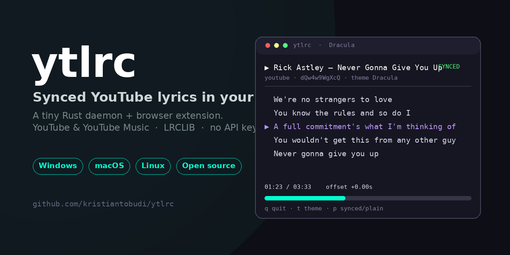

# ytlrc — YouTube lyrics in your terminal

[](https://github.com/kristiantobudi/ytlrc/actions/workflows/build.yml)
[](LICENSE)
[](CHANGELOG.md)
[](https://www.rust-lang.org)
[](#platform-support)



**English** · [Bahasa Indonesia](README.id.md)

**ytlrc** shows **synced YouTube lyrics in your terminal**. It is an open-source
command-line lyrics tool: a tiny Rust daemon plus a Chrome/Edge extension detects
the song playing on **YouTube or YouTube Music**, looks it up on
[LRCLIB](https://lrclib.net), and highlights the current line in a terminal UI as
the music plays. Works on **Windows, macOS, and Linux** — no API keys, no account,
no audio fingerprinting, ~1.4 MB binary.

> Looking for a way to see YouTube lyrics in the terminal, a CLI lyrics player, a
> synced LRC viewer, or a lightweight now-playing overlay? That is exactly what
> ytlrc does.

```
┌─ Now Playing ─────────────────────────────────────┐
│ ▶ Rick Astley — Never Gonna Give You Up    SYNCED │
│ youtube • dQw4w9WgXcQ  •  theme Dracula           │
├───────────────────────────────────────────────────┤
│        We're no strangers to love                 │
│        You know the rules and so do I             │
│   ▶    A full commitment's what I'm thinking of   │
│        You wouldn't get this from any other guy   │
├───────────────────────────────────────────────────┤
│ 01:23 / 03:33   offset +0.00s                     │
│ q quit · t theme · +/- offset · p synced/plain    │
└───────────────────────────────────────────────────┘
```

## Quick start

1. Install the browser extension once: see [Install the extension](#install-the-extension-once).
2. Build and run the daemon for your OS: see [Platform support](#platform-support).
3. Play something on YouTube. Lyrics appear automatically; switching songs
   triggers a new lookup without pressing anything.

```bash
# Linux / WSL (static binary)
./build.sh && ./ytlrc --bind 0.0.0.0

# macOS
./build.sh && ./ytlrc

# Windows (PowerShell)
.\build.ps1; .\ytlrc.exe
```

## Contents

- [Why ytlrc?](#why-ytlrc)
- [How it works](#how-it-works)
- [Features](#features)
- [Platform support](#platform-support)
- [Requirements](#requirements)
- [Build and run](#build-and-run)
- [Install the extension](#install-the-extension-once)
- [Files and configuration](#files-and-configuration)
- [CLI options](#cli-options)
- [Themes](#themes)
- [TUI keybindings](#tui-keybindings)
- [Automatic lookups explained](#automatic-lookups-explained)
- [FAQ](#faq)
- [Troubleshooting](#troubleshooting)
- [Project layout](#project-layout)
- [Contributing](#contributing)
- [Limitations](#limitations)
- [Credits](#credits)

## Why ytlrc?

| | **ytlrc** | Lyrics websites | Spotify-only lyric tools |
| --- | --- | --- | --- |
| Works with YouTube / YouTube Music | ✅ | ✅ | ❌ |
| Synced, auto-scrolling lyrics | ✅ | sometimes | ✅ |
| Runs in the terminal (SSH, tmux, tiling WM) | ✅ | ❌ | ❌ |
| Open source, no account, no API key | ✅ | ❌ | ❌ |
| One small native binary (Windows/macOS/Linux) | ✅ | ❌ | ❌ |
| Automatic retries and song-change detection | ✅ | ❌ | ❌ |

## How it works

```
Chrome / Edge / Brave (youtube.com, music.youtube.com)
  content.js   reads mediaSession title/artist, currentTime, duration, ads
      │ chrome.runtime.sendMessage (~1s or on every change)
      ▼
  background.js selects the tab you are watching ── POST /state
                                                       │
                                                       ▼
                                          Rust daemon (127.0.0.1:8765)
                                            • title parser → artist/title
                                            • LRCLIB (/api/get → /api/search)
                                            • per-track disk cache
                                            • LRC parser + offset
                                                       │
                                                       ▼
                                             ratatui TUI in your terminal
```

Detection uses page metadata and `mediaSession`, **not** audio fingerprinting,
so the exact `currentTime` can drive lyric sync. Works on Windows, Linux and
macOS.

## Features

- Automatic song detection with synced (LRC) lyrics and active-line highlight.
- **5 interactive themes**: Neon, Dracula, Nord, Gruvbox, Mono. Switch without
  restarting; the choice is remembered.
- **Layered automatic lookup**: when a lookup fails, ytlrc retries on its own
  with different queries (main artist, channel name, title only, raw cleaned
  title) using a backoff of 8s → 25s → 90s → 240s → every 5 minutes.
- **Song changes are picked up automatically**, including live streams or mixes
  that change songs without changing the video id.
- Stale-state protection: if the displayed lyrics ever stop matching the current
  track, a new lookup starts immediately (no manual reload).
- Ad-aware: lyrics pause during ads and resume afterwards.
- Multi-tab safe: only the tab you are actually watching is forwarded.
- Manual offset (`+` / `-`), synced/plain toggle, cache-bypassing refetch, and
  manual search.
- `--print` mode for scripts/stream overlays.
- One static binary, no runtime. Typical RAM usage ~10–15 MB.

## Platform support

| OS | Status | Notes |
| --- | --- | --- |
| **Windows 10/11** | Native `.exe` or WSL | Native build recommended; WSL still supported |
| **Ubuntu / Debian / Fedora / Arch** | Static musl binary | No runtime dependencies |
| **macOS 12+ (Intel & Apple Silicon)** | Native build | Xcode Command Line Tools needed to build |

The browser extension is identical on every OS. The daemon listens on
`127.0.0.1:8765` by default; only the WSL launcher binds `0.0.0.0` so Windows can
reach it.

CI tests and builds the project on Ubuntu, macOS and Windows, and produces the
static Linux binary on every push.

## Requirements

- Rust (stable) — only needed to build: <https://rustup.rs>
- `curl` on `PATH` (used for LRCLIB requests). Present by default on Windows 10+,
  macOS and most Linux distributions.
- Chrome, Edge, Brave or another Chromium browser with Manifest V3 support.

## Build and run

### Windows (native, recommended)

1. Install **Rust** (rustup) with the default MSVC toolchain.
2. Install **Visual Studio Build Tools** with the *Desktop development with C++*
   workload (the Rust MSVC linker needs it).
3. In PowerShell:

   ```powershell
   cd D:\Project\ytlrc
   .\build.ps1
   .\ytlrc.exe
   ```

   `build.ps1` builds `target\release\ytlrc.exe` and copies it to `.\ytlrc.exe`.

Use **Windows Terminal** for Unicode colors and the progress gauge. On the old
`cmd.exe`, run `chcp 65001` first.

### Windows (WSL)

```bash
cd /mnt/d/Project/ytlrc
./build.sh                                   # static Linux binary
./ytlrc --bind 0.0.0.0                       # required for a Windows browser
```

From Command Prompt, `ytlrc.cmd` starts the WSL build and passes
`--bind 0.0.0.0` automatically so the Windows browser can reach the daemon.

### Ubuntu / Linux

```bash
sudo apt install -y curl        # if curl is missing
cd /mnt/d/Project/ytlrc
./build.sh
./ytlrc
```

`build.sh` produces a static musl binary (`target/x86_64-unknown-linux-musl/release/ytlrc`)
and copies it to `./ytlrc`. It works on distributions without `gcc` by using
`rust-lld` plus a portable Zig toolchain for build scripts. If your machine has
`build-essential`, plain `cargo build --release` works too.

### macOS

```bash
xcode-select --install           # once, provides clang
cd ~/ytlrc
./build.sh                       # or: cargo build --release
./ytlrc
```

- Apple Silicon builds `aarch64` natively; Intel builds `x86_64` natively.
- For a universal binary:
  `rustup target add x86_64-apple-darwin aarch64-apple-darwin` then build both
  and combine with `lipo -create -output ytlrc ...`.
- iTerm2, Terminal.app and VS Code terminals all work; iTerm2 gives the best
  color rendering.

### Manual build (all platforms)

```bash
cargo build --release
# Linux:   target/release/ytlrc
# macOS:   target/release/ytlrc
# Windows: target\release\ytlrc.exe
```

### Using several devices

- Each machine runs its own daemon and its own copy of the extension. Nothing is
  synchronized between devices.
- Load the extension separately on every browser profile
  (`Load unpacked` → the `extension/` folder).
- The daemon only accepts connections from the same machine by default
  (`127.0.0.1`). To control a daemon that runs on another computer, start it
  with `--bind 0.0.0.0`, point `DAEMON_URL` in `extension/background.js` to
  `http://<that-ip>:8765/state`, add it to `host_permissions`, and reload the
  extension. Only do this on a trusted network: the endpoint has no
  authentication.
- Binaries downloaded from CI/releases: on macOS run
  `chmod +x ./ytlrc && xattr -d com.apple.quarantine ./ytlrc`; on Windows,
  SmartScreen may ask for confirmation the first time.

## Install the extension (once)

1. Open `chrome://extensions` (or `edge://extensions`, `brave://extensions`).
2. Enable **Developer mode**.
3. Click **Load unpacked** and select the `extension/` folder.
4. Pin **ytlrc bridge**. It runs automatically; no clicking needed.
5. Start the ytlrc daemon, then play something on YouTube.

If you change the daemon port, update `DAEMON_URL` in
`extension/background.js` and `host_permissions` in `extension/manifest.json`,
then reload the extension.

## Files and configuration

The daemon uses the standard per-user directories:

| OS | Config | Cache |
| --- | --- | --- |
| Linux | `~/.config/ytlrc/config.json` | `~/.cache/ytlrc/` |
| macOS | `~/Library/Application Support/dev.ytlrc.ytlrc/config.json` | `~/Library/Caches/dev.ytlrc.ytlrc/` |
| Windows | `%APPDATA%\ytlrc\ytlrc\config.json` | `%LOCALAPPDATA%\ytlrc\ytlrc\cache\` |

Delete those folders to reset the selected theme or force fresh lookups.

## CLI options

```
--print        no TUI; print the active lyric line to stdout (debug/scripts)
--bind <addr>  listen address (default 127.0.0.1; use 0.0.0.0 from WSL)
--port <port>  daemon port (default 8765)
--theme <t>    initial theme: Neon, Dracula, Nord, Gruvbox, Mono (or 1-5)
-h, --help
-V, --version
```

## Themes

| # | Name | Mood |
| --- | --- | --- |
| 1 | **Neon** | bright cyan and neon green |
| 2 | **Dracula** | purple/magenta Dracula palette |
| 3 | **Nord** | cool frost blue |
| 4 | **Gruvbox** | warm yellow/orange |
| 5 | **Mono** | black and white, maximum legibility |

- `t` cycles themes, `1`–`5` select directly (no restart).
- Themes use 24-bit color; Windows Terminal, iTerm2 and modern Linux terminals
  support it fully.
- The last theme is stored in `config.json` and restored on the next start.
- `--theme dracula` (or `--theme 2`) selects it at startup and saves the choice.

## TUI keybindings

| Key | Action |
| --- | --- |
| `q` / `Esc` | quit |
| `+` / `-` | shift lyrics by 0.25 seconds |
| `0` | reset offset |
| `p` | toggle synced ↔ plain |
| `t` | next theme |
| `1`–`5` | pick a theme directly |
| `r` | refetch lyrics now (bypass cache) |
| `m` | search manually `Artist - Title` |
| `↑` `↓` `PgUp` `PgDn` | scroll in plain mode |
| `Ctrl+C` | quit |

## Automatic lookups explained

1. Every new track (video id + normalized artist/title) triggers a lookup.
2. The first query uses the parsed artist/title; a miss falls back to six
   different query shapes, including title-only searches.
3. If nothing is found, ytlrc retries with the backoff shown above and keeps the
   countdown visible (`RETRY 8s`) until the track changes.
4. Lyrics are cached per track for 30 days; misses for 10 minutes.
5. Live streams and DJ sets that reuse one video id are handled because the cache
   key includes the track title, not just the video id.

Press `r` to retry immediately, or `m` to search manually (this disables
automatic retries for that track).

## Quick test without a browser

```bash
curl -s http://127.0.0.1:8765/health
curl -s -X POST http://127.0.0.1:8765/state \
  -H 'Content-Type: application/json' \
  -d '{"videoId":"dQw4w9WgXcQ","title":"Rick Astley - Never Gonna Give You Up (Official Video)","channel":"Rick Astley","duration":213,"position":83,"paused":false,"isAd":false,"source":"youtube"}'
curl -s http://127.0.0.1:8765/state
```

Headless mode:

```bash
./ytlrc --print
```

## FAQ

### How do I show synced YouTube lyrics in the terminal?

Run `ytlrc` on the same machine as your browser and install the extension. The
daemon receives the current video id, title, artist, and `currentTime`, fetches
synced LRC lyrics from LRCLIB, and scrolls them in a ratatui TUI.

### Does ytlrc work with YouTube Music?

Yes. Both `youtube.com` and `music.youtube.com` are supported; the extension reads
`mediaSession` metadata, which is more accurate on YouTube Music.

### Does it work on Windows without WSL?

Yes. Build a native `ytlrc.exe` with `build.ps1` (Rust MSVC toolchain). WSL is
still supported but no longer required.

### Does it need an API key, account, or login?

No. LRCLIB is public and requires no key. Nothing is uploaded; playback metadata
only travels from the extension to `127.0.0.1` on your own machine.

### Why do some songs show no lyrics?

LRCLIB is community-maintained: live sets, unreleased tracks, covers, and remixes
often have no synced lyrics. ytlrc retries automatically with alternative queries,
and `m` lets you correct the artist/title manually.

### Can I use it over SSH or inside tmux?

Yes — it is a normal terminal application (ratatui/crossterm). The browser and
daemon must still run on the same host, unless you bind the daemon to a LAN
address and point the extension at it.

### Does it support Spotify, local files, or Apple Music?

Not currently; detection is YouTube-specific. The lyrics engine and TUI are
decoupled, so additional sources would be a welcome contribution.

### Is it really that lightweight?

The release binary is about 1.4 MB (static musl on Linux), uses roughly 10–15 MB
of RAM, and has no runtime dependencies other than `curl`.

## Troubleshooting

**Extension never connects / status stays `WAITING`**
- Check the daemon: `curl http://127.0.0.1:8765/health`.
- On **WSL**, the daemon must bind `0.0.0.0` (`ytlrc.cmd` does this). Manually:
  `./ytlrc --bind 0.0.0.0`.
- On **Windows/macOS**, keep the default `127.0.0.1`. If you changed it, also
  update the extension URL and `host_permissions`.
- Windows Firewall may ask for permission the first time; allow it for private
  networks.

**Song changes but lyrics stay on the old track**
- Update the extension (`Load unpacked`) and the daemon: both were fixed so
  `mediaSession` is preferred over stale DOM nodes and cache keys include the
  track title.
- Make sure only one daemon runs: `curl /health` and check the version.
- As a last resort press `r`; please open an issue with the video URL if it
  still happens.

**`WAITING` after 20 seconds**
- The extension stopped sending updates (YouTube tab closed, extension
  disabled, or daemon restarted on a different port).

**Lyrics not found**
- Many live/remix/cover videos are not on LRCLIB. ytlrc keeps retrying on its
  own; `m` lets you correct the artist/title.
- Check the parsed title in the header.

**Lyrics drift out of sync**
- Use `+` / `-`; the offset is shown in the footer.

**Garbled characters / broken gauge**
- Use Windows Terminal or iTerm2. On legacy `cmd.exe`, run `chcp 65001`.

**Port 8765 already in use**
- `ytlrc --port 9000`, then update the extension URL and permissions.

**`linker cc not found` during a Linux build**
- Install `build-essential`, or let `build.sh` use its Zig fallback.

**`cargo` is not recognized on Windows**
- Reopen PowerShell after installing Rust, and make sure the MSVC toolchain is
  the default (`rustup default stable-msvc`).

## Project layout

```
ytlrc/
├─ .github/
│  ├─ workflows/build.yml       # CI: test + build on Linux, macOS, Windows
│  ├─ workflows/release.yml     # tagged releases with prebuilt binaries
│  ├─ ISSUE_TEMPLATE/           # bug report / feature request forms
│  └─ PULL_REQUEST_TEMPLATE.md
├─ .cargo/config.toml           # musl linker settings (Linux)
├─ build.sh                     # Linux static / macOS native build
├─ build.ps1                    # Windows native build
├─ ytlrc.cmd                    # CMD launcher (native .exe or WSL)
├─ CHANGELOG.md
├─ CONTRIBUTING.md
├─ SECURITY.md
├─ LICENSE
├─ src/
│  ├─ main.rs                   # arguments, daemon + TUI/print
│  ├─ model.rs                  # playback state + position extrapolation
│  ├─ theme.rs                  # 5 color themes
│  ├─ config.rs                 # stores the selected theme
│  ├─ server.rs                 # axum: POST /state, GET /state, GET /health
│  ├─ ui.rs                     # ratatui TUI, retries, --print mode
│  └─ lyrics/
│     ├─ mod.rs                 # cache + LRCLIB orchestration
│     ├─ lrclib.rs              # HTTP via curl + result scoring
│     ├─ lrc.rs                 # LRC parser
│     ├─ title.rs               # YouTube title parser
│     └─ cache.rs               # per-track JSON cache
├─ extension/
│  ├─ manifest.json
│  ├─ content.js
│  ├─ background.js
│  └─ icons/                    # 16/32/48/128 px extension icons
├─ docs/
│  ├─ ARCHITECTURE.md
│  ├─ GITHUB_SETUP.md           # publishing + SEO checklist
│  └─ social-preview.png        # 1280×640 repository card
└─ README.md / README.id.md
```

Tests and lints:

```bash
cargo test
cargo fmt --check
cargo clippy --all-targets
```

## Contributing

Issues and pull requests are welcome. See [CONTRIBUTING.md](CONTRIBUTING.md) for
the development setup, coding style, and how to test the browser extension.
Security reports: [SECURITY.md](SECURITY.md).

If ytlrc is useful to you, a ⭐ helps other people find the project.

## Limitations

- YouTube / YouTube Music only.
- Depends on LRCLIB; not every song has synced lyrics.
- Title parsing is heuristic; use `m` when the guess is wrong.
- Requires a Chromium-based browser (Manifest V3).

## Credits

- Lyrics: [LRCLIB](https://lrclib.net) — free, no API key.
- UI: [ratatui](https://ratatui.rs), server: [axum](https://github.com/tokio-rs/axum).
- License: MIT (see [LICENSE](LICENSE)).
